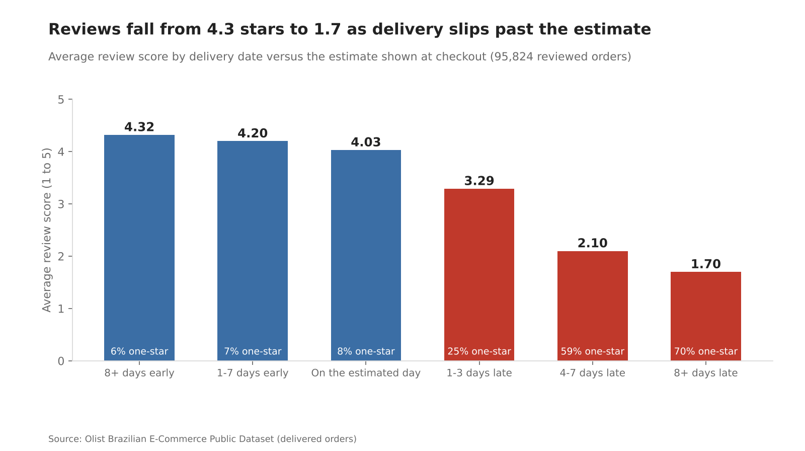

# Olist E-Commerce Analytics: SQL and Python

An analysis of about 100,000 real orders from the Olist marketplace in Brazil (2016 to 2018). The metrics are computed in SQL with DuckDB, and Python handles the statistical tests, charts, and pipeline.

The main finding: **orders delivered after the promised date score 2.27 stars on average, against 4.29 for on-time orders**, and the drop is graded by how late the order arrives.



## Key findings

| Area | Finding |
|---|---|
| Revenue | R$13.2M of item revenue on 96,470 delivered orders. It climbed through 2017, peaked in Black Friday month (R$988K, +52% on October), then levelled off near R$0.9M a month in 2018. Average order value stayed between R$124 and R$149, so growth came from volume. |
| Categories | 10 of 71 categories generate 62.4% of revenue. `health_beauty` leads with 9.3%. |
| Retention | 97.0% of customers ordered once. Under 1% of a cohort buys again in any given month (0.48% in month one across all cohorts, falling to 0.23% by month six). |
| Delivery | 6.7% of orders arrive late. They score 2.27 vs 4.29 (difference 2.02, 95% bootstrap CI 1.98 to 2.06). One-star reviews rise from 6% for early orders to 70% for orders 8+ days late. |
| Geography | Alagoas, Maranhão and Sergipe see 15% to 21% late deliveries against 4.5% in São Paulo. São Paulo, Rio and Minas Gerais are 63% of revenue. |
| Sellers | The top 10% of sellers earn 67% of revenue; the bottom half earn 3%. |
| Payments | 78.5% of payment value is by credit card, and 67% of card orders use instalments. Average basket grows from R$96 (single payment) to R$332 (7 to 10 instalments). |

Full commentary is in the [analysis notebook](notebooks/olist_analysis.ipynb).

## Approach

1. **Load and model.** Eight CSV files go into typed DuckDB tables (`sql/01_schema.sql`). Views deduplicate reviews to one per order and build a `delivered_orders` table with delivery metrics (`sql/02_views.sql`).
2. **Validate.** `sql/03_data_quality.sql` checks keys, duplicates, impossible dates, and orphan records. It found 775 orders with no items, 8 delivered orders with no delivery date, and 547 orders with multiple reviews, all handled explicitly.
3. **Analyse in SQL.** One query file per business question in `sql/analysis/`.
4. **Test and visualise in Python.** A Mann-Whitney U test, a bootstrap confidence interval and a Spearman correlation for the delivery finding, then charts built from the query results.

SQL techniques used: CTEs, window functions (`LAG`, `RANK`, `NTILE`, running `SUM() OVER`), moving averages, conditional aggregation, cohort analysis, RFM segmentation, date arithmetic, views and macros.

## Project structure

```
olist-ecommerce-analytics/
├── data/
│   ├── raw/                     8 Olist CSV files
│   └── README.md                provenance and validation of the data
├── sql/
│   ├── 01_schema.sql            typed tables
│   ├── 02_views.sql             order_value, latest_review, delivered_orders
│   ├── 03_data_quality.sql      integrity checks
│   └── analysis/                one file per business question
├── src/
│   ├── build_database.py
│   ├── run_analysis.py          runs every query, saves CSVs
│   ├── stats_tests.py           significance tests
│   └── make_figures.py
├── notebooks/olist_analysis.ipynb
├── reports/
│   ├── figures/                 charts (PNG)
│   └── results/                 query outputs (CSV) and stats summary
├── main.py
└── requirements.txt
```

## How to run

```bash
git clone https://github.com/AttaUllahHub/olist-ecommerce-analytics.git
cd olist-ecommerce-analytics
pip install -r requirements.txt
python main.py
```

This builds the database, runs all queries, runs the tests and regenerates every chart in a few seconds. To read the commentary with outputs, open `notebooks/olist_analysis.ipynb`.

## Data

Olist Brazilian E-Commerce Public Dataset, published by Olist on [Kaggle](https://www.kaggle.com/datasets/olistbr/brazilian-ecommerce) under CC BY-NC-SA 4.0. The CSVs here were checked against the official row counts and distributions; see [`data/README.md`](data/README.md) for how the copy was verified and what differs from the Kaggle files.

## Definitions and limitations

- Revenue is item price of delivered orders in Brazilian reais, excluding freight. Trend charts use January 2017 to August 2018 because 2016 has under 300 orders.
- An order is late when it arrives on a later calendar date than the estimate shown at checkout.
- Reviews are deduplicated to the latest one per order. Review scores exist for 95,824 of the 96,470 delivered orders.
- The lateness result is an association in observational data. Late orders also wait much longer (33.8 days against 11.0 on average), so the missed estimate and the long wait cannot be separated here.
- Orders with several sellers count towards each seller in seller-level review and lateness figures.
- With 97% one-time customers, the frequency dimension of the RFM segmentation separates very little. The segments are driven mainly by recency and spend.

## Author

Atta Ullah, BS Data Science, Government College University Faisalabad.
GitHub: [AttaUllahHub](https://github.com/AttaUllahHub)
